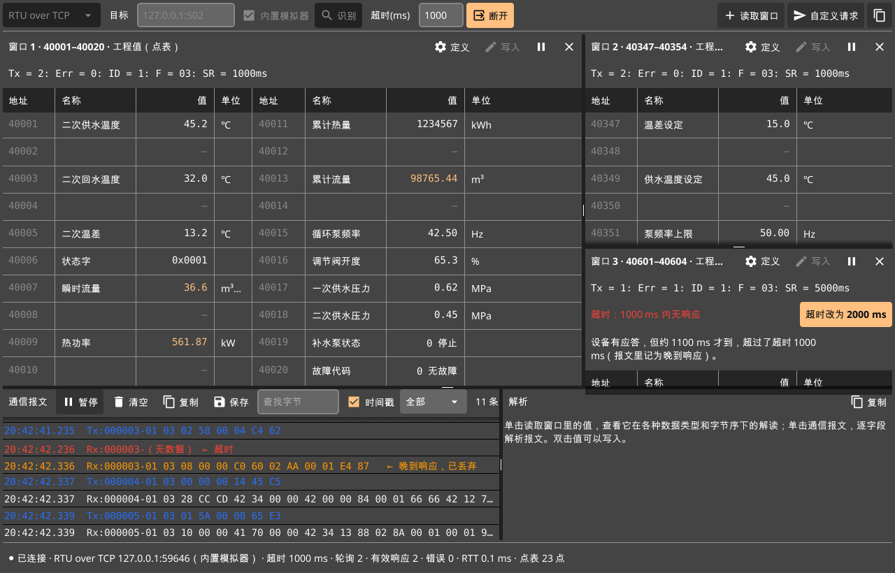

# Modbus AI Studio

面向工业现场的 Modbus 调试与诊断工具，Windows、macOS 可用，Linux 网关和服务器上有浏览器访问的 Web 版。界面参考 Modbus Poll；读不到数据时自动分析原因并给出一键处理，写入后回读确认设备真的执行了。

## 能做什么

- **连接**：Modbus TCP、RTU over TCP、ASCII over TCP、RTU 串口、ASCII 串口。不知道协议、站号、波特率时可以自动识别和扫描；断线自动重连；下次启动沿用上次的连接参数。
- **读取**：读取窗口可开多个，各自设置站号、地址和周期。显示格式有 16 / 32 / 64 位整型、FLOAT32 / FLOAT64、Hex、Binary、ASCII，16 位可字节交换，32 / 64 位四种字节序；可给单个或多个选中的寄存器单独设置类型和字节序，同一窗口支持混合类型。每个窗口的控制条直接切换功能码、整窗格式、字节序，可对照显示寄存器原始值。导入点表（xlsx、CSV，物联网平台导出的设备属性表也能直接用）后按名称、单位和工程值显示。
- **出错自动分析**：超时与晚到响应、异常码、校验错误、字节序不对、连接断开，都会说明原因，大多能一键处理（调超时、识别协议、探测可读地址、改字节序……）。
- **DeepSeek AI 诊断**：在“调试 → AI 诊断助手”、读取故障行“AI分析”或报文 / 日志 / 寄存器解析面板的“AI解释”打开。填写 API Key 并测试连接，预览冻结证据后获得带证据编号的事实、可能原因与人工检查步骤；明确显示分析对象，可取消、复制或导出包含证据的 Markdown 报告。默认不发送寄存器值、原始报文和日志自由文本；Windows API Key 使用当前用户加密保存。
- **寄存器检测**：主界面按钮及“调试 → 检测寄存器”按指定站号、功能码和地址范围检测，可自动定位（正常区段批量验证，失败区段定位到单个地址）、逐个寄存器读、按点表分段读、逐点独立验证（整段读与每个点单独读对照，找出整段有返回、单独却读不通的点），或快速排查（批量读后从全 0 段抽查，加控制点和边界对照，验证请求最多 16 次）；区分单独读取可读、批量有返回（未单独验证）、非法地址（异常 02）、非标准响应（如 89 回显请求）、无法判断和未检测，支持停止、复制结果和导出报告（Markdown 摘要、JSONL 请求与原始报文、CSV 失败清单）。默认沿用当前读取窗口的参数，也可在没有读取窗口时独立检测。Web 版和命令行 `modbus-cli probe` 用同一套检测。
- **写入验证**：写入后多次回读，判断是生效、未生效、被 PLC 改回，还是值不符；可以一键恢复原值。只读模式防止在生产设备上误写。
- **报文与日志**：逐字段解析每条报文，自定义请求可以发任意功能码，FC08 诊断计数器。日志页记录连接建立（本机端口 → 设备地址）、连接失败、读取失败与恢复、断开和重连，附原因分析、出错时的原始报文和出错前最近的收发；断开时分清设备关闭（FIN）、被复位（RST）还是网络中断；收发和日志存进标准 SQLite 文件，异常收发连同请求帧另存一张 anomalies 表，单个文件上限 50 MB，写满自动切换新文件，旧文件保留。程序内可选择文件查看历史和异常报文，也可用数据库管理工具打开。打开、保存工作区和读历史记录都在后台进行，大文件不卡界面。
- **多开与后台采集**：支持同时运行多个程序实例，也可在一个程序内新建多个主窗口，各自连接不同设备。关闭按钮默认隐藏到系统托盘，继续采集；托盘菜单可恢复窗口、再开窗口或退出本实例的所有窗口。连接、读取窗口和点表可以存成工作区文件。
- **窗口与图标**：应用、标题栏、任务栏和托盘统一图标；窗口按屏幕可用区域和 DPI 缩放适配，记住上次大小。连接与操作栏在窄窗口下自动换行，通信报文的操作和筛选分行显示。
- 内置换热站模拟器，没有设备也能上手。
- **软件更新**：“帮助 → 检查更新”下载新版本，校验 SHA-256 后替换程序并重启。
- **Linux Web 版**：在网关或服务器上运行 `modbus-web`，用浏览器连接设备、按点表读取、一键改站号、写入回读、识别协议、检测寄存器、看报文和日志，多个浏览器看到同一份状态；收发报文按天存进 SQLite，可在页面下载，在桌面版“历史报文 → 打开文件…”里查看。单个程序，x64 和 ARM64 都有。

## 下载

[GitHub Releases](https://github.com/xiaolengWangWang/modbus-ai-studio/releases) 提供 Windows 2.1.0；其他平台仍使用 2.0.0（国内访问慢时用 [Gitee 镜像](https://gitee.com/sun_xuanqi/modbus_ai_studio/releases)）：

| 文件 | 适用 |
| --- | --- |
| `ModbusAIStudio-2.1.0-Windows-x64.zip` | Windows 10 / 11 64 位。绿色版，解压后双击 `ModbusAIStudio.exe` |
| `ModbusAIStudio-2.1.0-Windows-x64-Compat.zip` | Windows 兼容版：远程桌面、虚拟机、老工控机、显卡驱动有问题，或 Windows 7 / 8 / 8.1 64 位。自带软件渲染，不依赖显卡；数据放在程序目录的 `data` 文件夹 |
| `ModbusAIStudio-2.0.0-macOS-AppleSilicon.dmg` | M 系列芯片的 Mac，macOS 12 及以上 |
| `ModbusAIStudio-2.0.0-macOS-Intel.dmg` | Intel 芯片的 Mac，macOS 12 及以上 |
| `ModbusAIStudio-Web-2.0.0-Linux-x64.tar.gz` | Linux x86-64 网关、服务器上的 Web 版。解压后运行 `./modbus-web`，用浏览器打开终端打印的地址 |
| `ModbusAIStudio-Web-2.0.0-Linux-arm64.tar.gz` | Linux ARM64（树莓派 4 / 5、多数 ARM 网关）上的 Web 版 |
| `modbus-cli-2.0.0-<系统>-<架构>.zip / .tar.gz` | 命令行工具 modbus-cli：windows-x64、macos-x64 / macos-arm64、linux-x64 / linux-arm64。加 `-json` 输出 JSON，方便脚本和 AI 调用，见 [命令行工具](docs/guide.md#命令行工具) |

Linux 桌面版没有安装包，可以 [从源码编译](docs/development.md#从源码编译)；网关、服务器上用 Web 版，见 [Linux Web 版](docs/guide.md#linux-web-版)。Windows 远程桌面、虚拟机里打不开时用兼容版；macOS 提示无法打开，见 [常见问题](docs/faq.md#安装与运行)。

Windows 同一版本提供标准版和兼容版。每个 macOS、Linux Web 发布包旁有对应的 `-differences.md`，记录与这两个 Windows 包的功能差异、缺失原因和后续处理决定；维护源文件见 [macOS 差异](docs/platform-parity/macos.md)及 [Linux Web 差异](docs/platform-parity/linux-web.md)。

## 快速上手

1. **先看示例**：打开程序，选菜单“读取 → 打开换热站示例”。会打开三个读取窗口并连接内置模拟器；窗口 3 故意应答慢，演示自动分析和一键处理。
2. **连接你的设备**：在顶部选协议，填 `IP:端口` 或选串口参数，点“连接”。不确定协议就点“识别”。
3. **读数据**：点上方操作栏的“新建读取窗口”，在“定义”里填 Slave ID、功能码、起始地址（手册上的 40001 写法即可）和数量。
4. **按点表显示**：有设备地址表时，用“读取 → 导入点表”导入 xlsx 或 CSV，读取窗口自动按点表显示名称、单位和工程值。

顶部操作栏可直接全部暂停 / 继续读取、切换只读模式；连接按钮旁显示连接进度与结果。通信报文可按错误、发送或接收筛选，配合字节搜索定位报文，一键清除筛选；计数区分别显示当前筛选条数、内存保留条数与累计条数。

## 文档

- [使用说明](docs/guide.md)：连接、读取、点表、写入验证、自动分析、报文与历史、工作区、只读模式、命令行工具、Linux Web 版、快捷键
- [点表格式](docs/points.md)：点表的列、数据类型、字节序、平台导出的设备属性表
- [常见问题](docs/faq.md)：连不上、超时、断开、异常码、值不对、写入失败、报文记录在哪里、安装问题
- [开发与发布](docs/development.md)：从源码编译、目录结构、测试、打包发版
- [SQLite3 数据文件](docs/sqlite-storage.md)：表结构、无损压缩、查询索引、旧文件兼容与快照导出
- [AI 功能设计](docs/ai-design.md)：已实现的 DeepSeek 诊断助手范围，以及配置建议、设备接入辅助等后续规划

## 目录

| 类别 | 目录 |
| --- | --- |
| 资源 | `assets/`：图标、点表模板、文档截图 |
| 核心代码 | `cmd/`、`internal/`、`tests/` |
| 平台代码 | `platform/`：Windows 专用代码，macOS / Windows 打包配置 |
| 文档 | `README.md`、`docs/` |
| 打包编译 | `build/`：macOS、Windows、Linux Web 版打包脚本，发版工具和图标生成器；`.github/workflows/`：持续集成 |
| 各版本构建文件 | `dist/vX.Y.Z/`：该版本安装包、差异说明、SHA-256 和发布记录；不提交到 Git |

## 许可证

[MIT](LICENSE)
